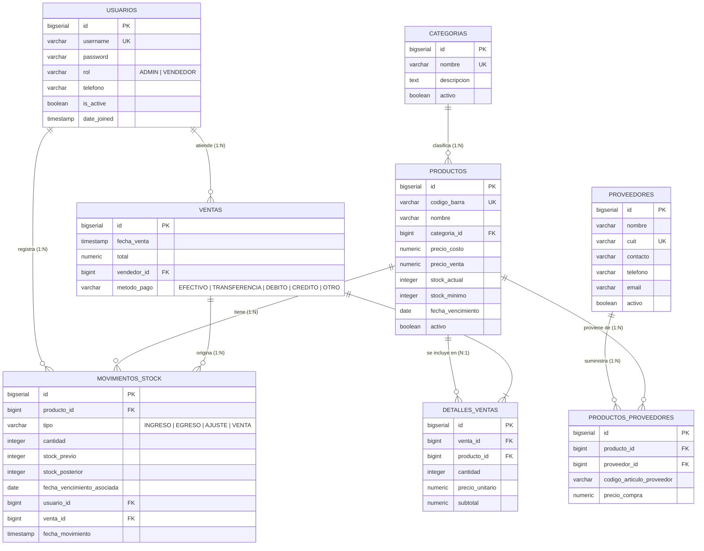

## 1. Diagrama Entidad-Relación (DER)

---

## 2. Diccionario de Datos

### 2.1 Tabla: `usuarios`
Estructura representativa para la gestión de usuarios y roles del comercio, orientada a la compatibilidad con Django Auth.

| Columna | Tipo de Dato | Nulo | Restricciones / Defecto | Descripción |
|---|---|---|---|---|
| `id` | BIGSERIAL | NO | PK | Identificador único del usuario |
| `username` | VARCHAR(150) | NO | UNIQUE | Nombre de usuario para iniciar sesión |
| `password` | VARCHAR(128) | NO | - | Hash de contraseña gestionado por Django |
| `rol` | VARCHAR(20) | NO | DEFAULT 'VENDEDOR', CHECK (rol IN ('ADMIN', 'VENDEDOR')) | Rol de acceso del usuario |
| `telefono` | VARCHAR(30) | SÍ | - | Teléfono de contacto |
| `first_name` | VARCHAR(150) | NO | DEFAULT '' | Nombre de la persona |
| `last_name` | VARCHAR(150) | NO | DEFAULT '' | Apellido de la persona |
| `email` | VARCHAR(254) | NO | DEFAULT '' | Correo electrónico |
| `is_staff` | BOOLEAN | NO | DEFAULT FALSE | Permiso de administración básica |
| `is_superuser` | BOOLEAN | NO | DEFAULT FALSE | Superusuario |
| `is_active` | BOOLEAN | NO | DEFAULT TRUE | Estado de la cuenta (activo/inactivo) |
| `date_joined` | TIMESTAMP TZ | NO | DEFAULT CURRENT_TIMESTAMP | Fecha de alta en el sistema |

---

### 2.2 Tabla: `categorias`
Clasificación de productos del kiosco (Golosinas, Bebidas, Cigarrillos, Snacks, etc.).

| Columna | Tipo de Dato | Nulo | Restricciones / Defecto | Descripción |
|---|---|---|---|---|
| `id` | BIGSERIAL | NO | PK | Identificador único |
| `nombre` | VARCHAR(100) | NO | UNIQUE | Nombre de la categoría |
| `descripcion` | TEXT | SÍ | - | Detalle o alcance de la categoría |
| `activo` | BOOLEAN | NO | DEFAULT TRUE | Estado lógico (baja suave) |
| `creado_el` | TIMESTAMP TZ | NO | DEFAULT CURRENT_TIMESTAMP | Fecha de creación |
| `actualizado_el`| TIMESTAMP TZ | NO | DEFAULT CURRENT_TIMESTAMP | Fecha de última edición |

---

### 2.3 Tabla: `proveedores`
Empresas y distribuidores mayoristas que proveen mercadería.

| Columna | Tipo de Dato | Nulo | Restricciones / Defecto | Descripción |
|---|---|---|---|---|
| `id` | BIGSERIAL | NO | PK | Identificador único |
| `nombre` | VARCHAR(150) | NO | - | Razón social o nombre fantasía |
| `cuit` | VARCHAR(20) | SÍ | UNIQUE | Identificación fiscal única |
| `contacto` | VARCHAR(100) | SÍ | - | Nombre de la persona de contacto |
| `telefono` | VARCHAR(30) | SÍ | - | Teléfono / WhatsApp |
| `email` | VARCHAR(254) | SÍ | - | Correo electrónico de pedidos |
| `direccion` | VARCHAR(255) | SÍ | - | Dirección física |
| `activo` | BOOLEAN | NO | DEFAULT TRUE | Estado lógico |
| `creado_el` | TIMESTAMP TZ | NO | DEFAULT CURRENT_TIMESTAMP | Fecha de creación |
| `actualizado_el`| TIMESTAMP TZ | NO | DEFAULT CURRENT_TIMESTAMP | Fecha de última modificación |

---

### 2.4 Tabla: `productos`
Artículos comercializados en el kiosco con control de stock y vencimiento simplificado.

| Columna | Tipo de Dato | Nulo | Restricciones / Defecto | Descripción |
|---|---|---|---|---|
| `id` | BIGSERIAL | NO | PK | Identificador único |
| `codigo_barra` | VARCHAR(64) | SÍ | UNIQUE, INDEX | Código de barras del artículo |
| `nombre` | VARCHAR(150) | NO | INDEX | Nombre comercial del producto |
| `descripcion` | TEXT | SÍ | - | Detalle o presentación |
| `categoria_id` | BIGINT | NO | FK -> `categorias(id)` ON DELETE RESTRICT | Categoría asociada |
| `precio_costo` | NUMERIC(12,2)| NO | DEFAULT 0.00, CHECK (>= 0) | Precio de compra al proveedor |
| `precio_venta` | NUMERIC(12,2)| NO | CHECK (>= 0) | Precio al público en mostrador |
| `stock_actual` | INTEGER | NO | DEFAULT 0, CHECK (>= 0) | Unidades físicas en kiosco |
| `stock_minimo` | INTEGER | NO | DEFAULT 5, CHECK (>= 0) | Umbral para alerta de reposición |
| `fecha_vencimiento`| DATE | SÍ | INDEX | Fecha de vencimiento próxima |
| `activo` | BOOLEAN | NO | DEFAULT TRUE, INDEX | Estado lógico |
| `creado_el` | TIMESTAMP TZ | NO | DEFAULT CURRENT_TIMESTAMP | Fecha de alta |
| `actualizado_el`| TIMESTAMP TZ | NO | DEFAULT CURRENT_TIMESTAMP | Fecha de actualización |

*Índices de rendimiento:*
- `idx_prod_stock_alert`: B-Tree (`stock_actual`, `stock_minimo`) para consultas instantáneas de faltantes.
- `idx_prod_vencimiento`: B-Tree (`activo`, `fecha_vencimiento`) para alertas de mercadería próxima a caducar.

---

### 2.5 Tabla: `productos_proveedores` (Relación M:N)
Tabla intermedia que relaciona productos con sus múltiples distribuidores.

| Columna | Tipo de Dato | Nulo | Restricciones / Defecto | Descripción |
|---|---|---|---|---|
| `id` | BIGSERIAL | NO | PK | Identificador único |
| `producto_id` | BIGINT | NO | FK -> `productos(id)` ON DELETE CASCADE | Producto relacionado |
| `proveedor_id` | BIGINT | NO | FK -> `proveedores(id)` ON DELETE CASCADE | Proveedor relacionado |
| `codigo_articulo_proveedor` | VARCHAR(64) | SÍ | - | Código interno del proveedor |
| `precio_compra`| NUMERIC(12,2)| SÍ | CHECK (>= 0) | Costo ofrecido por este proveedor |
| `creado_el` | TIMESTAMP TZ | NO | DEFAULT CURRENT_TIMESTAMP | Fecha de asignación |

*Restricción de Integridad:*
- `unique_producto_proveedor`: `UNIQUE(producto_id, proveedor_id)` para evitar duplicidad de vínculos.

---

### 2.6 Tabla: `ventas`
Encabezado transaccional de ventas realizadas en mostrador.

| Columna | Tipo de Dato | Nulo | Restricciones / Defecto | Descripción |
|---|---|---|---|---|
| `id` | BIGSERIAL | NO | PK | Número de ticket / comprobante interno |
| `fecha_venta` | TIMESTAMP TZ | NO | DEFAULT CURRENT_TIMESTAMP, INDEX | Momento del cobro |
| `total` | NUMERIC(12,2)| NO | DEFAULT 0.00, CHECK (>= 0) | Importe total cobrado |
| `vendedor_id` | BIGINT | NO | FK -> `usuarios(id)` ON DELETE RESTRICT | Vendedor responsable |
| `metodo_pago` | VARCHAR(20) | NO | DEFAULT 'EFECTIVO', CHECK (IN ('EFECTIVO', 'TRANSFERENCIA', 'DEBITO', 'CREDITO', 'OTRO')) | Medio de pago |
| `observaciones`| VARCHAR(255) | SÍ | - | Notas adicionales |

---

### 2.7 Tabla: `detalles_ventas`
Renglones o ítems incluidos en cada venta.

| Columna | Tipo de Dato | Nulo | Restricciones / Defecto | Descripción |
|---|---|---|---|---|
| `id` | BIGSERIAL | NO | PK | Identificador único de línea |
| `venta_id` | BIGINT | NO | FK -> `ventas(id)` ON DELETE CASCADE | Venta asociada |
| `producto_id` | BIGINT | NO | FK -> `productos(id)` ON DELETE RESTRICT | Producto vendido |
| `cantidad` | INTEGER | NO | CHECK (cantidad > 0) | Unidades vendidas |
| `precio_unitario` | NUMERIC(12,2)| NO | CHECK (>= 0) | Precio unitario al momento de la venta |
| `subtotal` | NUMERIC(12,2)| NO | CHECK (>= 0) | Total del ítem (`cantidad * precio_unitario`) |

*Restricción de Integridad:*
- `unique_venta_producto`: `UNIQUE(venta_id, producto_id)` para evitar renglones duplicados del mismo producto en una misma venta.

---

### 2.8 Tabla: `movimientos_stock` (Trazabilidad 1:N)
Registro inmutable de entradas, salidas, ajustes y ventas de mercadería.

| Columna | Tipo de Dato | Nulo | Restricciones / Defecto | Descripción |
|---|---|---|---|---|
| `id` | BIGSERIAL | NO | PK | Identificador único |
| `producto_id` | BIGINT | NO | FK -> `productos(id)` ON DELETE RESTRICT | Producto afectado |
| `tipo` | VARCHAR(20) | NO | CHECK (tipo IN ('INGRESO', 'EGRESO', 'AJUSTE', 'VENTA')) | Tipo de operación |
| `cantidad` | INTEGER | NO | CHECK (cantidad <> 0) | Cantidad movida |
| `stock_previo` | INTEGER | NO | CHECK (stock_previo >= 0) | Stock antes del movimiento |
| `stock_posterior`| INTEGER | NO | CHECK (stock_posterior >= 0) | Stock resultante tras la operación |
| `motivo` | VARCHAR(255) | SÍ | - | Causa (Compra, Rotura, Vencimiento, Venta mostrador) |
| `fecha_vencimiento_asociada` | DATE | SÍ | - | Vencimiento informado en el ingreso |
| `usuario_id` | BIGINT | SÍ | FK -> `usuarios(id)` ON DELETE RESTRICT | Responsable que ejecutó la acción |
| `venta_id` | BIGINT | SÍ | FK -> `ventas(id)` ON DELETE SET NULL | Venta vinculada cuando tipo = 'VENTA' |
| `fecha_movimiento` | TIMESTAMP TZ | NO | DEFAULT CURRENT_TIMESTAMP, INDEX | Fecha y hora exacta |

---

## 3. Vistas de Consulta (Lectura pura)

1. **`vista_alertas_stock_minimo`**: Identifica productos donde `stock_actual <= stock_minimo` categorizados en niveles (`CRITICO`, `BAJO`, `SIN STOCK`).
2. **`vista_alertas_vencimiento`**: Filtra productos próximos a caducar en 15 días o menos (`URGENTE`, `PROXIMO`, `VENCIDO`).
3. **`vista_productos_mas_vendidos`**: Calcula totales de unidades vendidas y montos recaudados por producto para el reporte de rotación.
